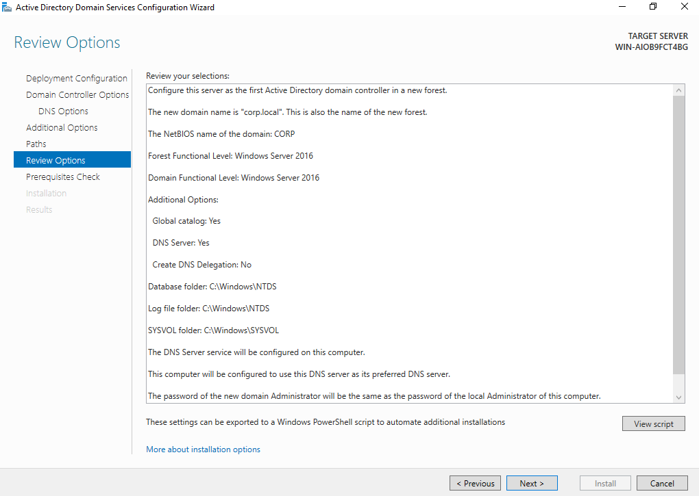

# Domain Controller Setup

## Environment
- Windows Server 2022 Standard (Desktop Experience).
- VirtualBox VM: 8GB RAM, 4 CPU cores, 60GB virtual disk, Internal Network (intnet).

## Static IP Configuration
- IP: 192.168.10.1 / 255.255.255.0 (Basic private IP address in the class C range).
- DNS: 127.0.0.0.1 (Referencing self, will function as a DNS server).

## Installation Steps
- Installed Active Directory Domain Services through the Add Roles and Features tool under Server Manager (Automatically pulled in the pre-configured DNS server for AD DS to function).
- Promoted the server to domain controller, added a new forest with the root domain corp.local
- Set DSRM password, and accepted the default NetBIOS name of CORP.
- Rebooted the system automatically, and logged back into VM with the CORP/Administrator domain showing everything worked.

## Verification
- Ran the 'dcdiag' command in PowerShell with a majority of core tests passing, minus a few that are not configured or otherwise functioning given the VM environment.
- Ran the 'Get-ADDomain' command in PowerShell as well to confirm a number of domain properties.
- Domain and DC promotion

## Additional Notes
- Issue: Initially installed the AD DS role and promoted the server to domain controller before manually configuring the static IP, subnet mask, and DNS settings. The subsequent AD DS and DNS Server didn't align with my intended scheme, and making these changes afterward did not propagate them correctly.
- Fix: Restored the VM from a baseline snapshot taken before any role installation, set the static IP/DNS settings on the appropriate adapter, and re-ran the AD DS installation and domain controller promotion.
- Takeaway: Retroactive reconfiguration of network settings after AD DS promotion is unreliable, always verify network configuration first, and take snapshots at key stages for reliable restoration and experimentation. In a real-world environment, such changes would instead go through a well-documented change management process.
