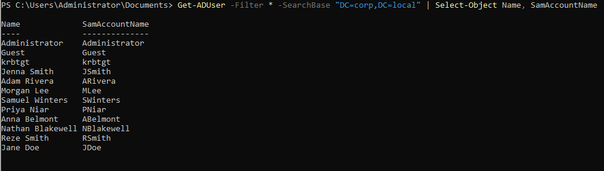
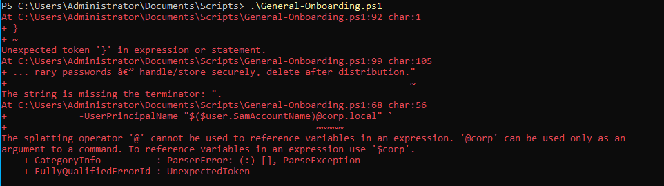
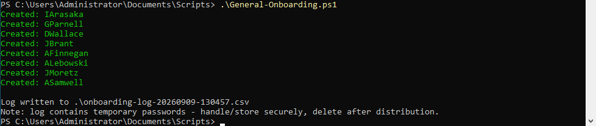

# Onboarding Script: Design Notes

## Why This Script Exists Separately From the Original Bulk Import

The original '03-ou-and-users.md' build phase used a minimal script to bulk-create users from a csv file, enough to prove the mechanisms worked, but it had some real weaknesses that I identified during my initial testing (one of the big ones in that doc's 'Additional Notes' section): the missing CSV header that silently produced false 'success' outputs and the naming collision with no validation catching issues.

The 'general-oboarding.ps1' script is a revised and improved upon version of the original script used in the lab, specifically addressing those weaknesses while bringing the script to a more practical and real-world onboarding process. Though considering the lab-based nature of this technical project, the scope of the script is rather limited compared to a production environment, and the script is not utilizing any additional ticketing systems, software, or integrating with other services. The highly indvidualized nature of technical stacks within organizations complicates a similar degree of emulation in a lab environment, so instead this scripting portion focuses solely on PowerShell with some best practices that would be relevant toward securely provisioning new users.

## What Changed and Why

Plaintext password removed from CSV
- The original script read pre-created passwords directly from the CSV file, these passwords were in plaintext. In any real-world context storing real account passwords in a plaintext file format for even a moment is a significant security liability. The revised script generates a 16-character temporary password per user and forces a password change at first logon. A couple of easily confused characters from the alphabet, alongside other numbers, like 'l,1,O,0., etc' were removed from the array of characters as there's no reason to make it needlessly complex for myself here.

Validation before user creation
- The original script attempted to create every user in the CSV immediately, one at a time, and only discovering problems as they arose (missing fields, duplicate account names) mid-run for a specific row. The revised script now checks the entire batch for all fields being present, queries AD for duplicate account names, confirms that the OUs exist, and creates nothing if there is a single row validation failure. This is a direct response to two of the issues I mentioned earlier in the lab in terms of the missing file header, the account name collision, and the silent failure of the script that printed out a succcessful message regardless of the complete failure in provisioning.

Accurate success / failure reporting
- Tee original script printed "Created user: X" unconditionally, regardless of whether the underlying New-ADUser call succeeded. Directly resulting in the initial failed runs still printing a misleading success message during labbing. The revised script wraps account creation in a try/catch with -ErrorAction Stop, so failures are caught and reported accurately.

## What this script isn't

This revised script is a step up from the original version, but it's still very much scoped toward the purposes of this self-contained lab, not a wholly accurate production onboarding tool. A few things a real organization's process would likely add, that is deliberately ignored here include:
- Integration with a ticketing/HR system that triggers onboarding automatically from an approved onboard request, rather than the manual preparation of a csv. An application or form that directly outputs to a csv file is one such option
- Previewing or dry-run support, realistically even with an audited and established onboarding script/process an administrator would want to preview these bulk changes before committing it to production or directly modifying a real working directory
- A secure credential handoff (emailing directly to a manager, integrating with a password manager, etc.) rather than logging temporary passwords to a file, even a local one

These are just a few of the many things that are beyond the scope of this lab project without a number of such technologies or systems directly relevant to an organizational context, but they are steps worth keeping in mind moving forward, particularly when I consider what integration is necessary for automation to be successful.

- Original Onboarding Script Result without Validation

- Improved Onboarding Script Error

- Improved Onboarding Script Successful

## Takeaway

Automation functions far beyond a simple did it work or not. Automation requires validation, accurate reporting, and established procedures that support higher level supervision. The revised script is a huge improvement, and some of the changes directly trace back to issues I had in the lab, while others were more security-focused changes that I would consider best practices at a baseline level.

